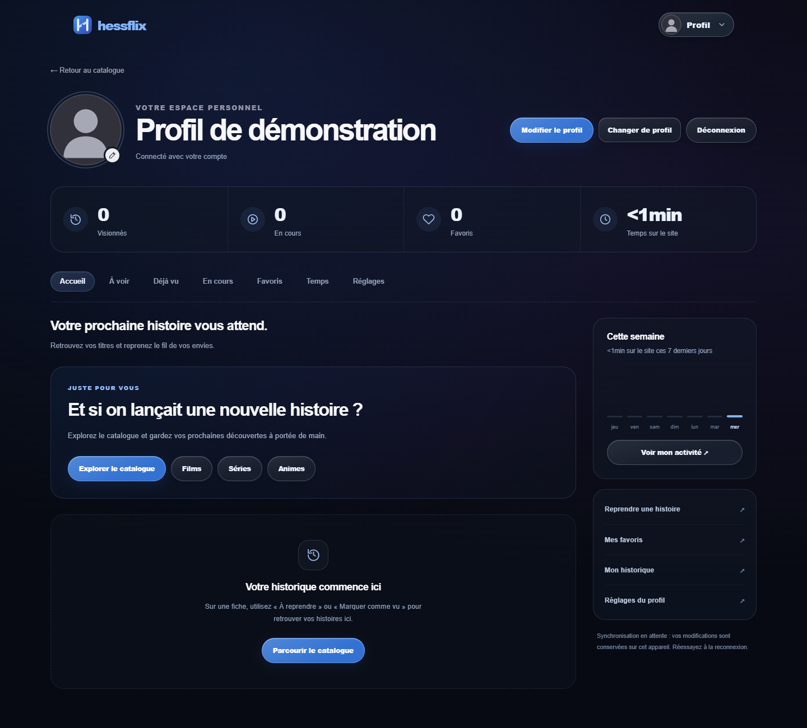
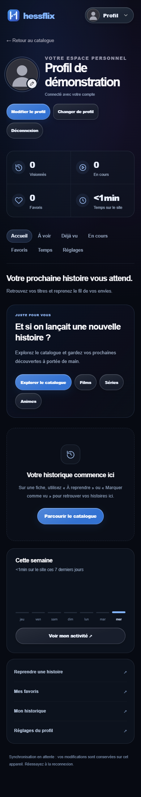

<div align="center">


# HESSFLIX

**Des histoires à découvrir. Un espace à soi.**

Films, séries et animes · Profils indépendants · Administration privée

[](package.json)
[](pnpm-lock.yaml)
[](firebase-auth.js)
[](https://www.themoviedb.org/)
[](LICENSE)

[Essayer la démo](https://zenox-pr.github.io/Hessflix/) · [Aperçu](#aperçu) · [Fonctionnalités](#fonctionnalités) · [Installation](#installation) · [Sécurité](#sécurité) · [Licence](#licence-et-droits-des-tiers)

</div>

---

## Le projet

Hessflix réunit la découverte de contenus, les listes personnelles et la gestion d'un catalogue validé par son administrateur. Son interface sombre associe des éclairages discrets, des composants translucides et des mises en page adaptées au mobile.

Ce dépôt partage le **code de l'application**, sous licence personnalisée non commerciale. Il ne fournit ni compte Firebase, ni clé privée, ni données utilisateurs, ni catalogue cloud du propriétaire, ni fichiers de films ou d'épisodes.

> **Application et démonstration séparées.** Les identifiants Firebase du code partagé sont fictifs. Le site complet exige votre propre configuration. La [démo GitHub Pages](https://zenox-pr.github.io/Hessflix/) fonctionne sans Firebase, avec un catalogue d'exemple et des profils locaux.

## Aperçu



<details>
<summary>Voir le profil sur mobile</summary>

<p align="center"></p>

</details>

Ces captures montrent les véritables pages de cette version avec le compte fictif `demo@example.test`, un avatar neutre et un catalogue vide. Les services sont simulés pour la capture ; aucune donnée réelle, affiche de film ou image de plateforme tierce n'y figure. [Provenance et reproduction](docs/images/SOURCES.md).

## Fonctionnalités

| Espace | Ce que le code propose |
| --- | --- |
| Découverte | Recherche normalisée, filtres et sélections de titres publiés ; pages par plateforme et univers Marvel distinct d'un abonnement. |
| Fiches | Métadonnées TMDB, synopsis, saisons, épisodes et contenus similaires lorsqu'ils sont disponibles. |
| Compte | Connexion Google ou e-mail/mot de passe avec Firebase Authentication, inscription et réinitialisation du mot de passe. |
| Profils | Plusieurs profils de spectateurs par compte, noms et avatars indépendants. |
| Listes | Favoris, À voir, En cours et Déjà vu séparés par profil ; synchronisation des comptes configurés et stockage local pour les visiteurs. |
| Suivi | Épisodes déclarés vus, choix de saison/épisode et activité du profil ; modifications en attente en cas d'échec de synchronisation. |
| Administration | Recherche TMDB, ajout en brouillon, publication explicite, modification, masquage, actualisation et suppression ; choix des plateformes et gestion des saisons/épisodes. |
| Vidéo | Association manuelle d'une URL d'intégration Vidmoly autorisée à un film ou à un épisode, avec brouillon, aperçu et validation séparés. |
| Interface | Adaptation mobile, navigation au clavier prévue par les composants et respect de `prefers-reduced-motion` pour le fond. |

**Limites.** TMDB fournit des informations, pas des vidéos ni des droits de diffusion. Le lecteur tiers ne fournit pas ici de progression de lecture vérifiable : le suivi est déclaratif. Le compteur de temps mesure l'activité sur le site, pas la durée réellement regardée. Les offres des plateformes peuvent changer et ne concernent pas nécessairement toutes les saisons. La disponibilité du lecteur dépend de Vidmoly et des restrictions du navigateur.

## Technologies et architecture

| Couche | Technologie vérifiée |
| --- | --- |
| Interface | HTML, CSS et JavaScript natifs ; aucun framework UI ni bundler requis. |
| Serveur | Node.js ≥ 22, serveur HTTP natif, modules CommonJS `.cjs`. |
| Authentification | Firebase JS SDK **13.1.0**, chargé depuis le CDN officiel. |
| Accès cloud serveur | Firebase Admin SDK **14.5.0**, Firestore et Application Default Credentials. |
| Métadonnées | API TMDB v3, appelée côté serveur. |
| Types | TypeScript **7.0.2**, `checkJs` et mode strict sur le périmètre défini dans `tsconfig.json`, qui n'inclut pas tout le serveur. |
| Tests | `node:test`, Playwright **1.64.1**, doubles de Firestore et tests de règles avec les émulateurs Firebase. |
| Dépendances | pnpm **11.25.0**, fichier de verrouillage versionné. |

```text
Hessflix/
├── index.html, titre.html, compte.html, connexion.html
├── *.js, *.css                 # Interface, profils, listes et lecteur
├── assets/                    # Visuels et leurs sources
├── server.cjs                 # Serveur HTTP et ressources publiques autorisées
├── server/                    # Sessions, autorisations, catalogue et stockage
├── admin-private/             # Document servi après contrôle de session
├── scripts/                   # Maintenance et contrôles de publication
├── tests/                     # Tests serveur, navigateur et règles
├── types/                     # Contrats et déclarations TypeScript
├── deploy/                    # Modèles IAM et indications d'hébergement
├── docs/                      # Captures et revue de documentation/licences
├── licenses/                  # Notices et inventaire des composants tiers
├── firestore.rules, storage.rules, database.rules.json
└── .github/workflows/         # Vérifications CI, sans déploiement
```

Les comptes sont communs à l'authentification. Les profils, listes et activités sont isolés par compte et profil côté serveur. Le catalogue privé et sa projection publique sont séparés dans Firestore. Les identifiants techniques historiques `Movix*` préservent les formats de stockage existants.

## Installation

Prérequis : **Node.js ≥ 22** et **pnpm 11.25.0**. **Java 21** est nécessaire uniquement pour les tests des règles avec les émulateurs. Depuis la racine de votre copie :

```sh
pnpm install --frozen-lockfile --ignore-scripts
```

Créer un fichier de configuration privé :

```powershell
# Windows PowerShell
Copy-Item .env.example .env
```

```sh
# Linux / macOS
cp .env.example .env
```

### Configurer votre instance

1. **Firebase Web** — créer votre projet et votre application Web ; renseigner leur configuration publique dans [`firebase-auth.js`](firebase-auth.js). Activer les fournisseurs d'authentification utilisés et autoriser le domaine local.
2. **Identité serveur** — remplacer les exemples `demo-hessflix` et `example-admin-uid` dans [`server/policy.cjs`](server/policy.cjs). Configurer les ADC avec une identité autorisée, en conservant tout fichier d'identité hors du dépôt.
3. **CSP et règles** — adapter le domaine d'authentification dans [`server/security-headers.cjs`](server/security-headers.cjs) et le même UID administrateur dans les trois fichiers de règles. Examiner les modèles IAM de [`deploy/`](deploy/README.md). Les règles présentes dans Git ne sont pas automatiquement déployées.
4. **Firestore** — créer la base de votre projet. Tester et appliquer explicitement vos règles et index lorsque votre environnement est prêt ; aucune commande de déploiement n'est exécutée par l'installation.
5. **TMDB** — renseigner `TMDB_API_KEY` dans `.env`, uniquement côté serveur. L'intégration Vidmoly actuelle n'utilise **aucune clé API** ; ne pas en placer dans le navigateur.

Voir [PUBLICATION.md](PUBLICATION.md), [TMDB.md](TMDB.md), [CATALOGUE_ADMIN.md](CATALOGUE_ADMIN.md) et [ADMIN_SECURITE.md](ADMIN_SECURITE.md). Certaines notes y décrivent l'historique du développement ; elles ne prouvent pas la configuration de votre instance.

### Lancer localement

```sh
pnpm start
```

Ouvrir **[http://localhost:4180](http://localhost:4180)**. Le serveur écoute sur l'interface locale. Les fonctions cloud exigent votre configuration ; aucun catalogue réel n'est livré avec cette copie.

Pour votre propre UID autorisé, `pnpm admin:check` puis `pnpm admin:grant` vérifient et attribuent le claim administrateur. La seconde commande modifie réellement le compte de **votre** projet : l'exécuter explicitement, uniquement après vérification de l'UID et de l'identité serveur. [Procédure](ADMIN_SECURITE.md).

## Vérifications

```sh
pnpm typecheck
pnpm test:server
pnpm test:publication
pnpm exec playwright install chromium
pnpm test:browser
pnpm security:publication
pnpm audit
pnpm audit --prod
```

`pnpm test` regroupe le contrôle des types, la suite serveur et les tests navigateur. Avec Java 21, `pnpm test:rules` exécute les moteurs de règles sur le projet d'émulation `demo-movix-admin`, pas sur une base de production.

Les tests simulés ne certifient ni le déploiement cloud, ni les droits de diffusion, ni la disponibilité d'une vidéo. Aucun badge de réussite CI, nombre d'utilisateurs ou score de sécurité n'est affiché : le workflow GitHub n'a pas été lancé pour ce dépôt. Les résultats datés et limites sont dans la [revue de documentation et de licences](docs/REVIEW.md).

## Sécurité

- Secrets, comptes de service, sauvegardes, exports, journaux, profils réels et états de navigateur restent hors de Git.
- Les routes administrateur vérifient la session Firebase, sa révocation, l'UID autorisé et le claim `admin` côté serveur. Les écritures exigent l'origine attendue et un jeton CSRF.
- Les opérations personnelles vérifient l'identité du compte et le profil ciblé. Les documents privés ne sont pas lisibles directement par le client Firestore.
- Le SDK Admin contourne les règles Firestore : les permissions IAM et les contrôles Node restent nécessaires.
- TMDB est appelé depuis Node. Les URL Vidmoly sont validées et le lecteur isolé ; aucune extraction de flux ni protection DRM n'est annoncée.
- La garde de publication examine les candidats, leur correspondance avec l'index et l'historique Git local accessible. Ce contrôle heuristique complète une revue humaine.

Consulter [SECURITY.md](SECURITY.md) pour signaler une vulnérabilité sans publier de secret. Le [manifeste de publication](PUBLICATION_MANIFEST.json) liste les fichiers préparés et leurs empreintes, sauf sa propre empreinte.

## Licence et droits des tiers

**Code source consultable ; utilisation non commerciale selon [LICENSE](LICENSE).** La licence personnalisée de **zenox-PR** porte uniquement sur les contributions originales dont il détient les droits. Leur exploitation commerciale exige son autorisation écrite préalable. Ce régime n'est pas une licence « open source » au sens de l'OSI.

Les composants tiers gardent leurs propres licences. L'autorisation de zenox-PR ne remplace pas celle d'un autre ayant droit. Médias, marques et métadonnées ne deviennent pas libres du seul fait de leur présence ici. Les droits de redistribution de certains visuels restent à confirmer **avant toute publication**.

Voir [THIRD_PARTY_NOTICES.md](THIRD_PARTY_NOTICES.md) et l'[inventaire des licences des dépendances](licenses/dependencies.json). Aucun composant tiers n'est relicencié sous la licence Hessflix.

## Crédits

- **TMDB** — métadonnées et images selon ses conditions. *This product uses the TMDB API but is not endorsed or certified by TMDB.*
- **JustWatch, via TMDB** — informations de disponibilité par pays et type d'offre ; elles peuvent évoluer.
- **Firebase, TypeScript, Playwright et pnpm** — composants et outils conservant leurs propres licences.
- **MovixOpenSource / movixstream** — référence de reconstruction et provenance d'avatars et de visuels ; les éléments concernés gardent leurs attributions, dont la licence CC BY-NC 4.0 du dépôt source vérifié.
- **TerminalLearning / thierryvm** — inspiration de la hiérarchie documentaire ; aucun code, logo ou capture de ce projet n'a été repris.

Sources détaillées : [crédits de l'application](credits.html), [avatars](assets/avatars/SOURCES.md), [visuels de plateformes](assets/platforms/SOURCES.md) et [contenus de découverte](assets/discovery/SOURCES.md).

---

<div align="center">

**HESSFLIX · Un projet indépendant**

Aucune affiliation ou approbation de la part des plateformes et ayants droit cités.

</div>

## Démonstration publique

[Essayer Hessflix dans le navigateur](https://zenox-pr.github.io/Hessflix/)

La version GitHub Pages est une **démo interactive** : catalogue d'exemple, profils fictifs,
favoris et suivi des épisodes enregistrés uniquement dans votre navigateur. Aucun compte réel
ni vidéo n'est proposé. Elle est indépendante du site complet utilisant Firebase.
Voir [le fonctionnement et les limites de la démo](docs/DEMO.md).
